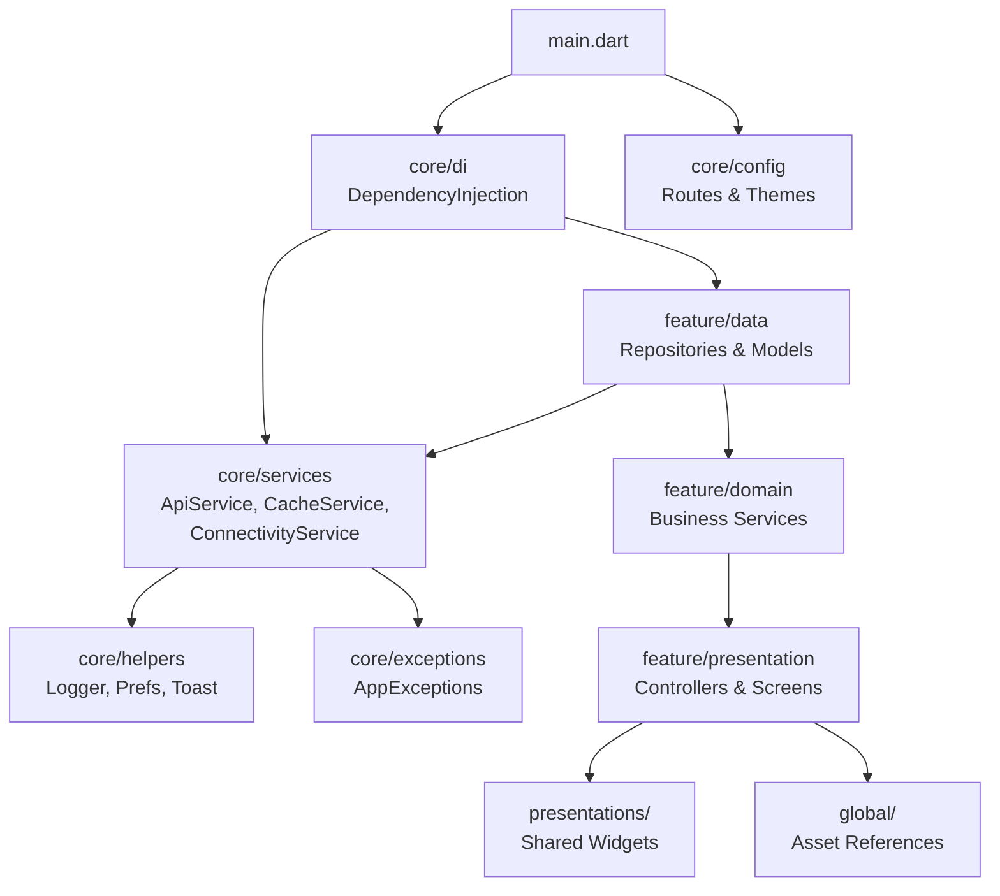

# Confaero App — Architecture & Folder Structure

## Overview

**Confaero App** is a Flutter mobile application (Android, iOS, Windows) for conference/event management. It allows attendees to browse events, view agendas, connect with other attendees, exchange messages, and receive notifications.

**Tech Stack:**
| Layer | Technology |
|---|---|
| Framework | Flutter (Dart SDK ^3.7.0) |
| State Management | **GetX** (`get`) |
| Navigation | **GoRouter** (`go_router`) |
| Networking | **Dio** (HTTP client) |
| Local Storage | **Hive** (via `hive_flutter`) |
| Responsive UI | `flutter_screenutil` |
| Real-time | **Socket.IO** (`socket_io_client`) |
| Fonts | Inter (custom bundled) |

---

## Root Folder Structure

```
confaero_app/
├── android/             # Android platform project
├── ios/                 # iOS platform project
├── windows/             # Windows platform project
├── assets/              # Static assets
│   ├── fonts/           # Inter font files
│   ├── icons/           # 68 icon assets
│   ├── images/          # Image assets
│   └── lottie/          # 5 Lottie animation files
├── lib/                 # 📂 Main application source (243 files)
├── pubspec.yaml         # Dependencies & configuration
└── analysis_options.yaml
```

---

## `lib/` — Application Source

```
lib/
├── main.dart            # App entry point
├── core/                # Shared infrastructure
├── features/            # Feature modules (Clean Architecture)
├── global/              # Generated asset references (flutter_gen)
└── presentations/       # Shared UI components
```

### Entry Point — [main.dart](file:///c:/Users/jahid/SPARKTECH/confaero_app/lib/main.dart)

Initializes dependency injection via `DependencyInjection.init()`, sets up `ThemeController`, and launches with `DevicePreview` (disabled), `ScreenUtilInit`, `ToastificationWrapper`, and `MaterialApp.router` using GoRouter.

---

## `core/` — Shared Infrastructure

```
core/
├── config/
│   ├── approutes/       # GoRouter route definitions
│   └── appthemes/       # Light/dark theme data
├── constants/
│   ├── api_constants.dart    # Base URLs, endpoints
│   ├── app_colors.dart       # Color palette
│   ├── app_constants.dart    # App-wide constants
│   └── app_strings.dart      # Static strings
├── di/
│   └── dependency_injection.dart  # GetX DI setup
├── exceptions/
│   └── app_exceptions.dart   # Custom exception classes
├── helpers/
│   ├── logger_helper.dart         # Logging utility
│   ├── network_connection.dart    # Network-aware UI wrapper
│   ├── prefs_helper.dart          # SharedPreferences wrapper
│   └── toast_message_helper.dart  # Toast/notification helper
└── services/
    ├── api_service.dart           # Dio HTTP client wrapper
    ├── cache_service.dart         # Hive caching layer
    └── connectivity_service.dart  # Internet connectivity monitor
```

**DI initializes in this order:** Core Services → Repositories → Domain Services → Controllers (all lazily via GetX).

---

## `features/` — Feature Modules

Each feature follows a **Clean Architecture** pattern with up to 3 layers:

```
feature/
├── data/           # Models, repositories (API calls & caching)
├── domain/         # Business logic services
└── presentation/   # Controllers (GetX) & Widgets (UI screens)
```

### Feature Modules

| Module | Description | Layers |
|---|---|---|
| **auth** | Sign in, sign up, forgot/reset password, OTP verification | data → domain → presentation |
| **Events** | Event listing, event details, floor maps | data → domain → presentation |
| **attendees** | Attendee profiles, browsing, connections (largest module ~128 files) | data → domain → presentation |
| **agenda** | Event agenda/schedule views | presentation only |
| **message** | Messaging / chat functionality | domain → presentation |
| **notification** | Push & in-app notifications | presentation only |
| **community** | Community features | data → presentation |
| **onboarding** | Onboarding/intro screens | presentation only |
| **bottomNavbar** | Bottom navigation bar shell | presentation (+ standalone screen) |
| **mainattendees** | Main attendees listing view | presentation only |

---

## `presentations/` — Shared UI Components

```
presentations/
├── controller/
│   └── theme_controller.dart  # Theme mode management
└── widgets/
    ├── custom_button.dart
    ├── custom_loader.dart
    ├── custom_network_image.dart
    ├── custom_text.dart
    └── custom_text_field.dart
```

Reusable UI building blocks consumed by all feature modules.

---

## `global/` — Generated Assets

Auto-generated by `flutter_gen` — provides type-safe asset references for images, icons, SVGs, and Lottie files.

---

## Architecture Diagram



## Key Architectural Patterns

1. **Feature-first organization** — Each feature is self-contained with its own data/domain/presentation layers
2. **GetX for everything** — State management, dependency injection, and reactive programming
3. **GoRouter for navigation** — Declarative routing with `MaterialApp.router`
4. **Repository pattern** — Data layer abstracts API calls from business logic
5. **Lazy initialization** — All dependencies created on first access via `Get.lazyPut`
6. **Network-aware UI** — `NoInterNetScreen` wrapper checks connectivity globally
7. **Socket.IO** — Used for real-time features (messaging/notifications)
